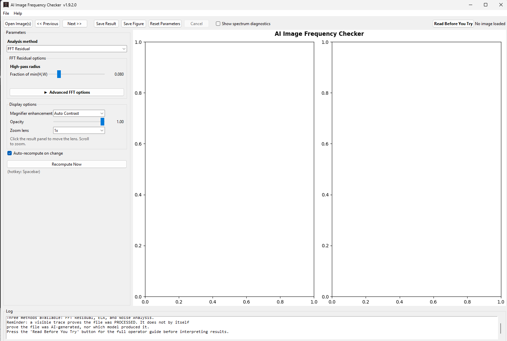
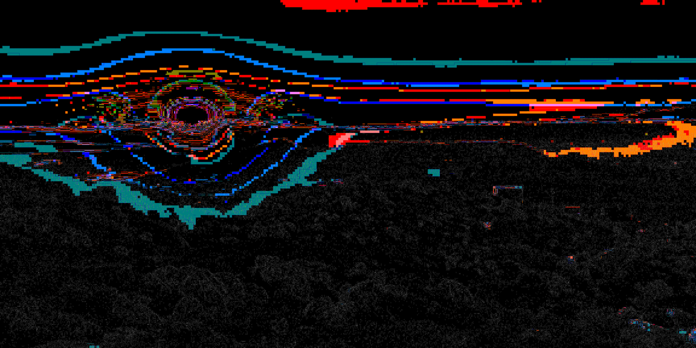
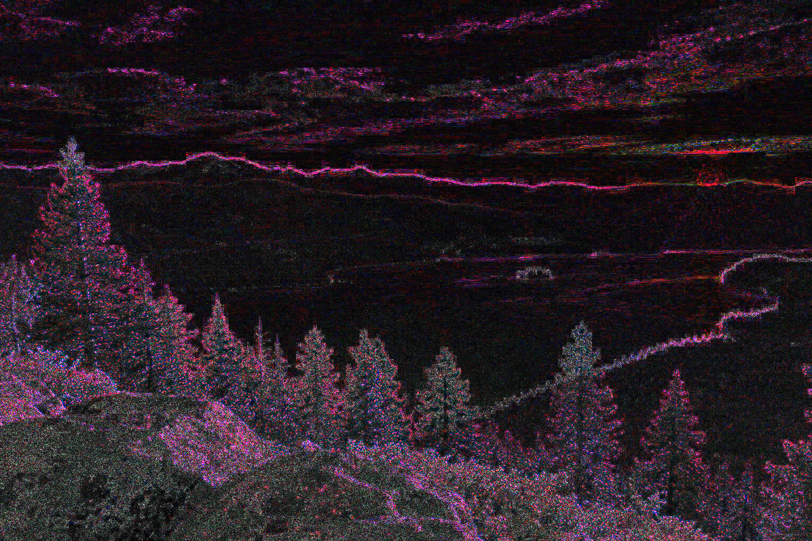

***

# AI Image Frequency Checker

A desktop application that extracts and amplifies the **high-frequency residual** of an image. This makes faint patterns left by compression, resampling, upscaling, and AI generative pipelines visible to the human eye.

Written in Python using OpenCV, NumPy, and Matplotlib, with a Tkinter interface. Ships as a standalone Windows executable.

---

## Table of Contents

- [What the application does](#what-the-application-does)
- [The mathematics](#the-mathematics)
- [The four-panel visualisation](#the-four-panel-visualisation)
- [Features](#features)
- [Requirements](#requirements)
- [Running from source](#running-from-source)
- [Operator tips](#operator-tips)
- [How to read the output](#how-to-read-the-output)
- [What this tool can and cannot prove](#what-this-tool-can-and-cannot-prove)
- [Limitations](#limitations)

---

## What the application does

Every digital image has two layers of information:

1. **Low-frequency content:** The actual picture. This includes broad shapes, colors, and lighting.
2. **High-frequency content:** The fine details and the record of how the file was processed. This includes JPEG blocks, sharpening halos, sensor noise, and the patterns left by AI models.

Because the processing fingerprint is so weak, it is invisible in normal viewers. This application removes the picture and amplifies the fingerprint.

### Forensic Clues: Camera vs. AI
One of the primary uses of this tool is distinguishing between physical sensor noise and mathematical generation.

**Real Camera Sensors:**
Physical sensors have organic properties. Due to the way light hits the sensor and how cameras compress images, noise and artifacts often cluster into organic shapes. In the amplified residual, you will often see "blobs" or patterns that are oval or round. This is a result of physical light diffusion and the way organic textures are handled by camera hardware.


**AI Generated Images:**
Diffusion models and GANs generate images using a mathematical grid known as latent space. Because they operate on a coordinate system of pixels, the noise they leave behind is fundamentally different. AI noise is usually:
* **Completely Random:** Stochastic noise in all directions with no organic clustering.
* **Grid-Based:** When patterns do emerge, they are almost always square or rectangular. This "checkerboard" artifact is a common signature of the convolutional kernels used in U-Net architectures and AI upscaling algorithms.

By comparing the shape of the noise (organic and round vs. mathematical and square), an operator can find strong clues about the origin of an image.

### Intended use

- **Triage:** Quickly find images with inconsistent processing histories.
- **Comparison:** Compare a suspected image against a known original.
- **Education:** See how re-saving or rescaling changes an image's frequency profile.

---

## The mathematics

### 1. Pre-processing
The image is converted to grayscale and normalized to a range of `0.0` to `1.0`.

### 2. Frequency transformation
The app uses a 2D Discrete Fourier Transform (FFT) to break the image down into spatial frequencies. We use `fftshift` to move the zero-frequency (the DC term) to the center, allowing us to apply a radial mask.

### 3. High-pass filtering
A circular mask blocks the center of the spectrum (the low frequencies) and lets the outer edges (the high frequencies) pass through. 
* **Radius:** Set as a fraction of the image size so it works on any resolution.
* **Feather:** A smooth edge is applied to the mask to prevent "ringing" artifacts that could be mistaken for evidence.

### 4. Inverse transformation
The filtered spectrum is converted back into a visual image using an Inverse FFT.

### 5. Signal amplification
Because the residual is very faint, it is amplified using:
* **Robust Percentile Stretch:** Maps the bulk of the signal to 0-1, ignoring "hot pixels" that would otherwise ruin the contrast.
* **CLAHE:** A local contrast boost that makes faint structures pop without blowing out the bright areas.
* **Linear Gain:** A final multiplier for brightness.

---

## The four-panel visualisation

**Operator Note:** By default, the application only displays the **Original image** and the **Final Residual** (Panels 1 and 4). To view the frequency-domain data, check the **"Show spectrum diagnostics"** box in the GUI. For most triage and analysis tasks, Panels 2 and 3 are not necessary.

| Panel | Content | Visibility |
| --- | --- | --- |
| **1** | Original image (grayscale) | **Default** |
| **2** | Magnitude spectrum (the frequency map) | Diagnostics Only |
| **3** | Masked spectrum (showing what was blocked) | Diagnostics Only |
| **4** | Final amplified residual | **Default** |

---

## Features

- **Multi-image loading:** Step through a collection of files.
- **Live tuning:** Parameters update in real-time via background threads.
- **Responsive UI:** The window never freezes during analysis.
- **Export options:** Save results as 8-bit PNGs or high-res figures.
- **Resolution independent:** Settings scale automatically to the image size.
- **Unicode safe:** Works with Windows paths containing non-English characters.

---

## Requirements

**Source:**
- Python 3.10+
- `numpy`, `opencv-python`, `matplotlib`
- Tkinter (standard with Python)

**Executable:**
- Windows

---

## Running from source

```bash
pip install -r requirements.txt
python AI_image_frequency_checker.py
```

---

## Operator tips

- **Sweep the radius:** Start at 0.08. Lower values (0.03) show fine texture; higher values (0.15) reveal gross upscaling grids.
- **Check the feather:** If a pattern only appears when feather is 0, it is likely a mathematical artifact of the tool, not evidence.
- **Use Robust Stretch:** This prevents a single bright pixel from turning the whole image black.
- **Compare references:** Always compare a suspect image to a known "clean" photo from the same source.

---

## How to read the output

| Observation | Likely explanation |
| --- | --- |
| Fine random noise | Normal sensor or compression noise |
| Regular grid or cross-hatch | AI upscaling or tiling artifacts |
| Blocky 8x8 patterns | Standard JPEG quantization |
| Bright edges only | Heavy sharpening applied |
| One region differs from the rest | Inpainting or compositing |

---

## What this tool can and cannot prove

### It can expose:
* Periodic lattices from AI upscalers.
* JPEG re-compression history.
* Resampling signatures from editing.
* Inconsistencies between original and regenerated regions.

### It cannot prove:
* **AI Origin:** A photo saved in several different apps can also produce a structured residual.
* **Specific Model:** It shows *that* a file was processed, not necessarily *which* model did it.
* **Provenance:** This is a visual aid, not a legal verification tool.

---

## Limitations

- **Visual only:** No statistical p-values or automated classifiers.
- **Memory usage:** Very large images (50MP+) require significant RAM for FFT calculations.
- **Grayscale:** The tool analyzes luminance, not color-channel subsampling.
- **Not forensic-grade:** Use established forensic software for court-admissible evidence.